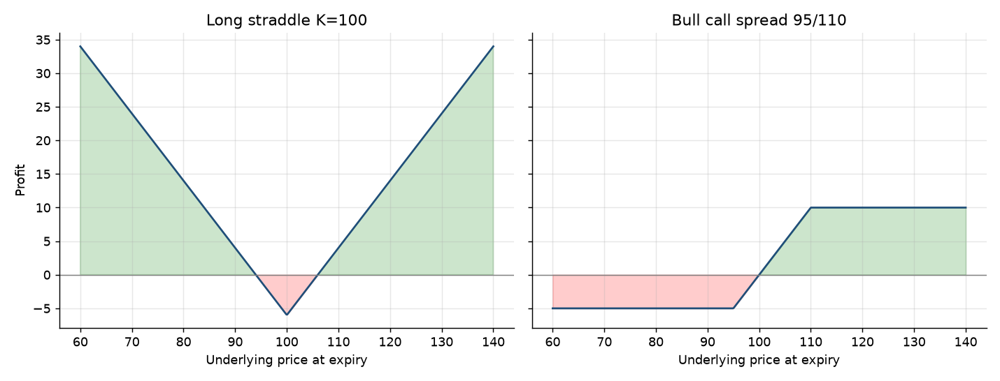

# Option Payoff Engine

Phase 1 of an option pricer I am building step by step in Python.

It computes the payoff and profit of calls and puts at expiry, describes any option strategy as a list of legs, and finds its maximum profit, maximum loss and break-even points.

## What it does

- **Single options:** payoff and profit of long calls and puts, after the premium paid.
- **Vectorised with NumPy:** the same functions run on 500 prices at once, so every strategy can be plotted.
- **Any strategy:** each leg is a dictionary (type, strike, quantity, premium) and `strategy_profit` adds up the legs.
- **Key numbers:** max profit, max loss and break-even, found where the profit changes sign.

| Strategy | Break-even | Max profit | Max loss |
|---|---|---|---|
| Long straddle K=100 (premium 3 + 3) | 94 / 106 | Unlimited | −6 |
| Bull call spread 95/110 (debit 5) | 100 | 10 | −5 |

## Files

- `Phase1_payoff_logic.ipynb`: the notebook, with code and charts.

## Roadmap

- [x] Phase 1: payoff and profit logic, multi-leg strategies, break-even
- [ ] Phase 2: price options with Black-Scholes and compute the Greeks
- [ ] Phase 3: compare the model with listed options on Bloomberg

## Tools

Python, NumPy, Matplotlib, Jupyter.

---
Massimo Carlo Moia · MSc Finance and Investment Banking, Grenoble Ecole de Management
